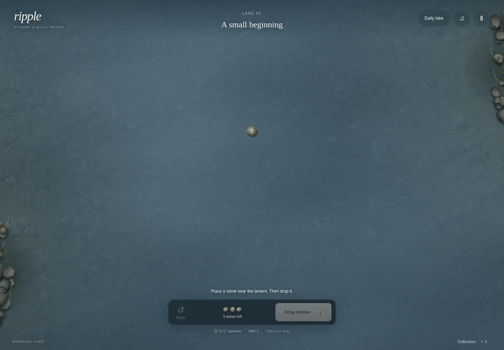

# Ripple

A calm wave-interference puzzle, built for HTML5 browsers with **Canvas 2D + vanilla JavaScript**. No framework, fonts, images, music files, runtime packages, or asset downloads. Water, lanterns, rocks, stones and particles are drawn in code; sound is synthesized with WebAudio.



## Play and upload

Requirements: Node.js 20+ for the development tools. The game itself runs in a browser.

```sh
npm start
```

Open **http://localhost:4173**. Use HTTP rather than opening `index.html` as a `file://` URL: ES modules and workers need a web origin.

```sh
npm run build
```

This creates:

- `dist/` — static production files; no test/solution console harness.
- `releases/ripple-crazygames.zip` — upload this ZIP to CrazyGames. `index.html` is at the ZIP root.
- `reports/build.json` — measured compressed/uncompressed sizes.

To test exactly the production files: `node tools/serve.mjs dist`.

In the CrazyGames submission, enable **Progress Save / Data Module**. Test the upload in the portal preview with SDK Inspector, an ad blocker, and normal/rewarded ad scenarios before submitting for review. The repository does not submit or publish the game to CrazyGames automatically.

## How to play

1. Tap open water to place a stone. All stones fall together when you press **DROP**.
2. Light every lantern. Overlapping positive wave heights add together; reflected waves count too.
3. Before pond 15, tap a stone to remove it, or drag it to move it. From pond 15, tap a stone to cycle its delay through **0 / 1 / 2 seconds**; drag outside the pond to remove it.
4. **RESET** clears the stones. Failed drops keep them, so you can adjust immediately. There are no lives, timers or attempt limits.
5. Use at most par stones for three stars, par + 1 for two, otherwise one. Beating par gets its own celebration.

From pond 3, faint gold sanctuaries protect the water around lanterns. You cannot place stones inside them. This closes the obvious “drop directly on each lantern” shortcut. Reflections can still yield clever below-par solutions.

Ponds 1–10 are fixed and verified. Pond 3 introduces interference; two failed attempts on ponds 3–5 reveal faint launch rings. Rocks arrive on pond 7, larger puzzles on pond 10, optional timed stones on pond 15. Every fifth late pond includes a delayed stone in its certified solution.

## Progression

- Four pond themes, unlocked at 0 / 10 / 20 / 30 stars, change the palette, stones and ambient chord.
- The Daily Pond unlocks after pond 3. Its seed uses the UTC day; all players receive the same geometry, independent of their progression.
- Daily streak and text share card with clipboard fallback.
- Three daily goals with small bonuses; replaying a completed pond cannot repeatedly farm its stars or goals.
- Local save in standalone mode. When the initialized CrazyGames SDK Data module is present, it becomes the save backend. Cloud data is read before writing; a late initialization reconciles earned progress.
- Mid-level placement, delays, attempts and completed reward screens survive reloads.

The first pond is the initial screen: no menu or logo barrier. A pulsing placement cue appears after five seconds. Chimes, particles, a brief slow-motion/zoom finish and the daily-unlock reveal follow the player's actual actions. The requested 0:15 / 0:45 / 1:30 milestones are pacing targets, not forced timers. Browser autoplay restrictions mean sound starts with the first user gesture.

## Simulation and generation

All physics/gameplay parameters are in `src/config.js`; authored geometry lives in `src/scripted.js`. Visual drawing coordinates are in the renderer/CSS.

- Fixed 128 × 128 `Float32Array` height, previous-height and peak grids on every device.
- `hNew = fround((2*h - hOld + 0.22*laplacian(h)) * 0.996)`.
- Reflective zero-gradient pond and rock boundaries, implemented through self-neighbour substitution.
- Arithmetic quartic bumps, amplitude 1, radius 4; both height buffers receive the same bump.
- A 60 Hz accumulator advances two simulation steps per tick. A failed drop lasts 360 steps / three simulated seconds, independently of display refresh rate. Delays are exact integer step offsets.
- No trigonometric/exponential functions in the physics or seeded generator. Trigonometry is only used for cosmetic drawing/audio.
- Seeded Mulberry32 RNG, integer placements, deterministic shuffle and candidate ordering.
- Generated lanterns require combined peak >= `1.15*T`, and each constituent single-stone peak <= `0.7*T`. Every returned level has a solution certificate. Placement and spacing checks are applied as well.
- The optimized generator simulates the entire single-stone height field but records single-stone peaks only at already eligible lantern cells. Tests establish equality with full peak tracking at those cells; this does not approximate the simulation.
- The next level and daily pond are generated in a worker while the current pond is playable. Fixed onboarding ponds load without runtime generation. If workers are unavailable, generation falls back to the main thread.

Generation uses a seeded mirrored pair plus random extra stones, rather than unrestricted independent random placement. This makes constructive bands more reliable and keeps resampling rare. Rocks are included before evaluating any wave solution. Par is the construction budget, **not a proof of the minimum possible stone count**.

## Validation and tuning

```sh
npm test                         # deterministic physics, saves/rewards, SDK failure handling
npm run calibrate                # one-stone and two-stone peak tables
npm run benchmark                # 300 levels, 24 black-box search attempts each
node tools/benchmark.mjs 30 48    # smaller/custom search
node tools/script-levels.mjs     # rebuild fixed onboarding after intentional physics changes
```

F3 toggles a debug overlay: level time, attempts, session drops, generation time, seed, step and lantern peaks versus threshold. F3 does not reveal a solution. The development-only `?test` harness is stripped by the build tool.

### Calibration

`T = 0.065`, using a centered stone in an empty reference pond:

| Distance in cells | Single-stone peak | Lights |
|---|---:|---|
| 15 | 0.08990 | Yes |
| 20 | 0.06530 | Yes |
| 25 | 0.04938 | No |
| 30 | 0.03733 | No |
| 40 | 0.03476 | No |
| 50 | 0.03632 | No |

Two stones at (40,64) and (88,64) produce 0.06863 at (64,104), approximately 46.6 cells from each stone. Two stones at (36,64) and (92,64) each produce 0.04157 at (64,64); together they produce 0.08314. Boundaries and rocks can focus waves, so these reference distances are not universal distance cutoffs.

### 300-level measurement

Measured on Node 24.19.0 / AMD EPYC 9V74. `reports/benchmark.json` contains every seed and result; `reports/benchmark-before-tuning.json` preserves the baseline.

| Metric | Before peak-tracking optimization | After |
|---|---:|---:|
| Verified solution + margin failures | 0 / 300 | 0 / 300 |
| Generation median | 203.3 ms | 182.0 ms |
| Generation p90 | 225.2 ms | 215.6 ms |
| Generation maximum | 331.8 ms | 303.7 ms |
| Generations >= 200 ms | 179 / 300 | 71 / 300 |
| Blind bot solved within 24 attempts | 161 / 300 | 161 / 300 |
| Median / p90 attempts, solved levels only | 13 / 23 | 13 / 23 |
| Median / p90 with budget-capped failures | 23 / 24 | 23 / 24 |
| First-attempt solves flagged as potentially trivial | 4 / 300 | 4 / 300 |

The bot uses randomized hill climbing and only public geometry/peak feedback; it never reads `level.solution`. Its 139 failed searches are budget exhaustion, **not impossible levels**: every construction certificate passed. The unchanged solve counts also verify that peak-tracking optimization preserves generated puzzles.

Tuning performed: threshold calibration; fixed, symmetric interference lessons on ponds 3–4; tighter mirrored-pair separation; candidate selection near constructive bands; sparse peak tracking; 48 px minimum touch hit regions; and near-miss arcs around unlit lanterns after a failed drop.

**Remaining targets:** generation is not below 200 ms in every case, and the blind solver does not meet a 3–6-attempt target. The worker removes generation from the interactive thread but does not make the raw computation faster. Human 60–120-second levels, 20-minute sessions, first-minute conversion and next-day retention require real playtests/portal analytics; they are not proven by these tools. Treat the later curve as a playtest candidate, not finished commercial balance.

### Browser and visual test

```sh
npm install --no-save --package-lock=false playwright@1.56.1
npx playwright install --with-deps chromium
npm run test:browser
```

GitHub Actions runs the same checks and uploads screenshots, the browser report and the upload ZIP as **ripple-validation-and-upload**. The script checks initial interaction, mid-level restore, all ten onboarding solutions, failed attempts, delays, pause/resume, daily sharing, 320/390 px portrait layouts, 844 px landscape, and 60/144 Hz peak equality.

**Release QA passed:** 14 unit tests and all 11 browser check groups; zero browser errors. First contentful paint was **164 ms** in headless Chromium on GitHub Actions (not a universal network/device load guarantee). The blocked-SDK route was explicitly exercised. See [the successful run](https://github.com/kallevanderveen8-lang/Riippel/actions/runs/39632741119) and `reports/browser.json`.

Desktop, [portrait](docs/mobile.webp) and [landscape](docs/landscape.webp) screenshots were visually inspected. Short-viewport spacing was corrected so the pond and instructions stay above the footer. Viewport tests do not substitute for real iPhone/Android performance or Safari testing. Live monetization requires the CrazyGames preview/production environment.

## SDK and advertisement behavior

`src/sdk.js` loads the official v3 SDK only on a detected CrazyGames host/embed (or when explicitly testing with `?sdk`). Its failure, blocking or absence leaves the game usable. On the portal, gameplay events begin after SDK initialization and reflect placing, simulation, pauses and completion screens.

- No ad requests for the first 180 seconds.
- Midgame requests only at completion, at least five newly completed ponds apart.
- Shared 180-second cooldown prevents midgame/rewarded chains.
- Opt-in, labelled rewards: one solution ring, double a level's star reward once, or one daily-goal reroll.
- Reward controls are hidden without an available SDK/ad module, with detected adblock, during cooldown, and after known monetization-disabled errors.
- Pause and mute around requests; success, error, unfilled, thrown exceptions and timeout recover safely. Rewards only follow a finished callback and are guarded against duplicate callbacks.
- Visibility/manual pause preserves the current attempt; no Escape or Ctrl+W game binding.

Official integration references: [SDK introduction](https://docs.crazygames.com/sdk/intro/), [game events](https://docs.crazygames.com/sdk/game/), [video ads](https://docs.crazygames.com/sdk/video-ads/), [Data module](https://docs.crazygames.com/sdk/data/).

## Implementation map

| File | Responsibility |
|---|---|
| `simulation.js` | Fixed grid, walls, impulses, RNG, deterministic time |
| `levels.js`, `scripted.js`, `generator-worker.js` | Construction, certificates, onboarding, pre-generation |
| `renderer.js`, `audio.js` | Water shading, lanterns, particles, synthesized sound |
| `main.js` | Interaction, frame accumulator, progression flow, responsive UI bindings |
| `progress.js` | Saves, stars, daily goals and streaks |
| `sdk.js` | Optional portal, storage and advertisement adapter |
| `tools/` | Local server, calibration, black-box bot, benchmark, browser test and ZIP builder |

Build process followed: (1) physics/rendering, (2) placement/drop/lighting, (3) seeded construction/certificates, (4) onboarding/stars, (5) retention/saves, (6) audio/celebration, (7) SDK/pause/ads, (8) responsive and touch pass, (9) calibration/300-level bot/tuning, followed by browser/visual QA and packaging.
